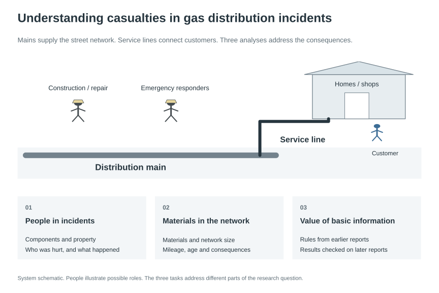
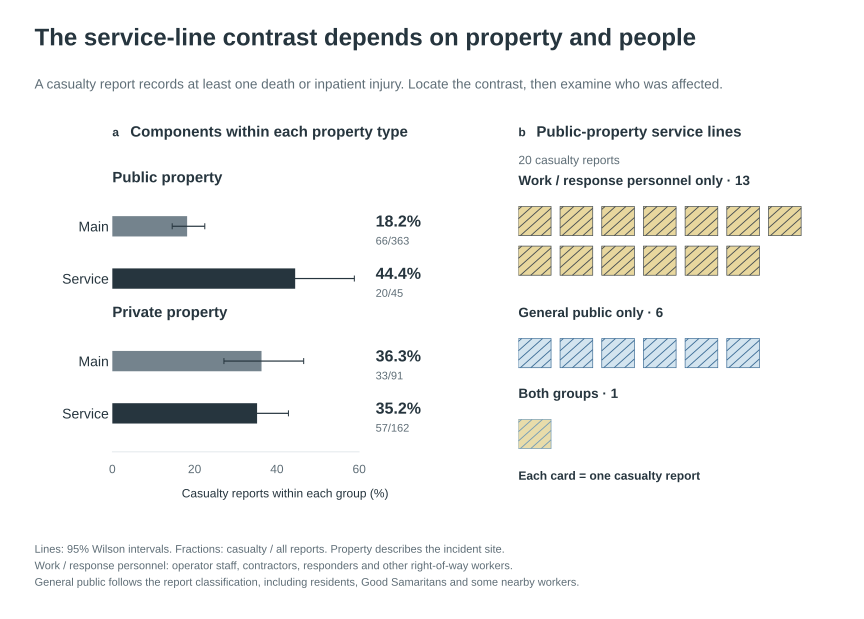
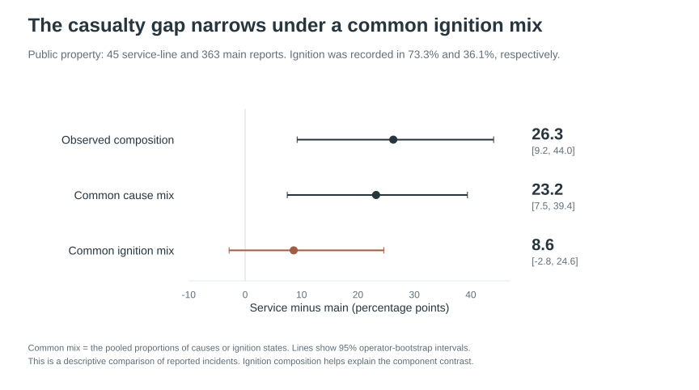
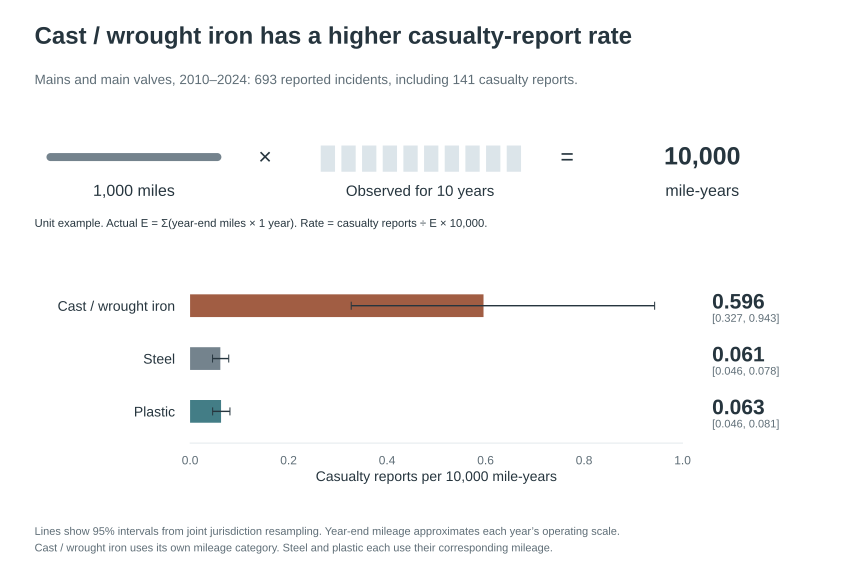
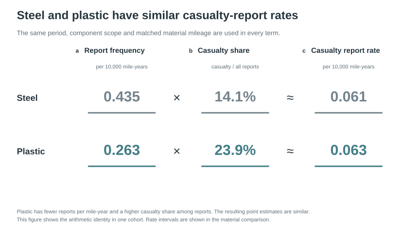
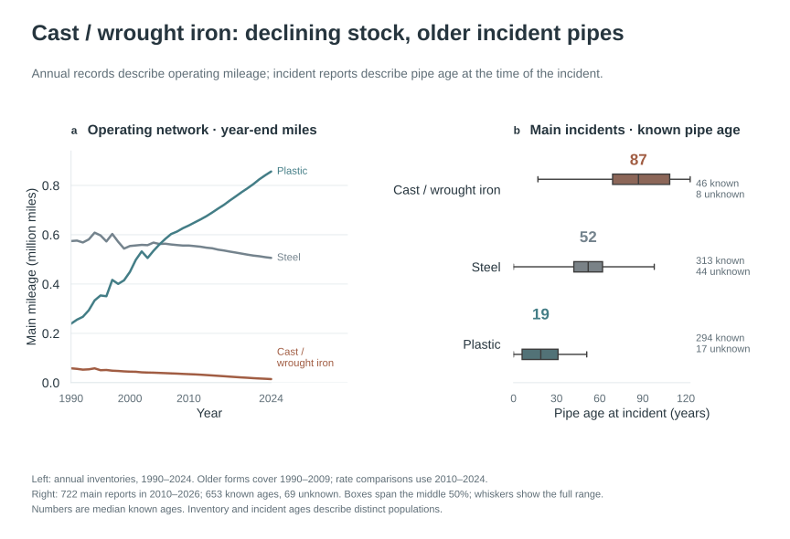
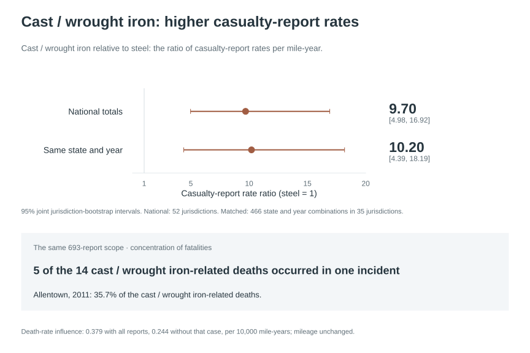
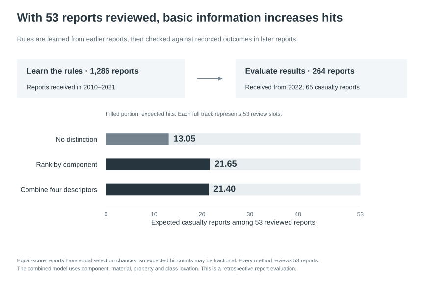
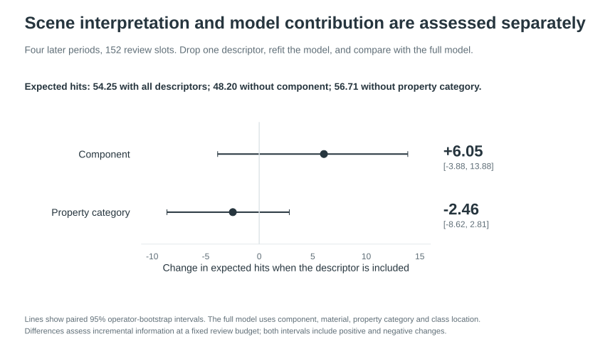

# People harmed in US gas distribution incidents

Gas distribution networks deliver fuel to homes and businesses. Mains carry gas through neighbourhoods, while service lines connect mains to individual customers. Inspection and accident review require decisions about which parts of these networks deserve attention. Components, materials and locations offer a practical starting point because they describe both the infrastructure and the setting in which an incident occurred.

Our question is whether this basic information can reliably identify reported incidents involving death or injury requiring hospital admission, and how those judgements should be explained. A service line connects a customer, which naturally directs attention towards residents. An incident involving that line can also affect maintenance crews, construction workers or emergency responders. Similarly, the number of incidents involving a material acquires a different meaning once we know how much of that material remains in use.

Figure 1. Mains supply neighbourhoods and service lines connect customers. People and positions are schematic. The study examines personnel in incidents, materials in the network, and the identification value of basic information.

We analyse 1,550 US gas distribution incident reports from the Pipeline and Hazardous Materials Safety Administration, or PHMSA. The incidents occurred from January 2010 to February 2026. Of these reports, 369 record at least one death or injury requiring inpatient hospital admission. We call these casualty reports. They contain 142 deaths and 652 inpatient injuries; one report can involve several people. PHMSA also requires reports for qualifying losses, gas releases and other significant events, so the study compares consequences within this reported population. [PHMSA incident data](https://www.phmsa.dot.gov/data-and-statistics/pipeline/distribution-transmission-gathering-lng-and-liquid-accident-and-incident-data)

Annual network records provide a second kind of evidence. Material inventories cover 1990–2024, and installation-decade inventories cover 2004–2024. They describe the amount and age structure of infrastructure in use. Together, the two sources support an investigation of people and accident settings, a comparison of materials relative to network size, and a test of how much the basic information helps identify casualty reports. Each comparison contributes to the same practical aim: a more specific basis for accident review and attention to existing networks. [PHMSA annual distribution data](https://www.phmsa.dot.gov/data-and-statistics/pipeline/gas-distribution-gas-gathering-gas-transmission-hazardous-liquids)

## 1. Service lines, incident locations and the people affected

### The component difference varies by property type

We began with a specific expectation: because service lines connect customers, their higher casualty proportion would mainly involve the general public and would appear across different locations. The first comparison establishes the overall difference. Among 241 service-line reports, 90 involved casualties, a proportion of 37.3%. Among 726 main reports, 146 involved casualties, or 20.1%.

Mains and service lines account for 967 of the 1,550 reports. The remaining reports concern meters, regulators, risers, valves and other components. The complete category comparison retains these facilities, while the main-versus-service comparison gives us a clear starting point for examining the original expectation. Each proportion has the number of reported incidents involving that component as its denominator.

The next step is to locate that difference. PHMSA records four property categories: public property, private property, utility right-of-way or easement, and operator-controlled property. A utility right-of-way or easement covers land with rights to install, operate or maintain utility facilities. PHMSA records it separately from public and private property. We compare these categories, then use narratives to establish the buildings, activities and people involved.

Figure 2. The component comparison becomes more informative when we distinguish property types and identify the people harmed. Each report card represents one incident report.

On public property, the casualty proportion was 44.4% for service lines and 18.2% for mains, a difference of 26.3 percentage points. Resampling operators together gave a 95% interval of 9.2–44.0 percentage points. Private-property proportions were close, at 35.2% and 36.3%, respectively. The right-of-way comparison was 37.5% for service lines and 16.9% for mains; the operator-controlled category contained eight reports. These findings locate the overall component difference and direct the investigation towards people harmed in those settings.

Reports from the same operator can share operating practices and infrastructure. We therefore keep an operator's reports together when resampling, then recalculate the comparison. The interval describes the uncertainty in the estimated group difference, while the underlying counts show exactly which recorded incidents contribute to it.

### Workers and responders in public-property service-line incidents

PHMSA distinguishes the general public from four other recorded groups: operator employees, contractors working for the operator, external emergency responders, and other workers in the right-of-way. We combine the latter four as workers and responders. The public category follows PHMSA's reporting definition and can include spontaneous helpers and some affected workers outside the right-of-way. These are recorded identities; the narrative establishes what a person was doing. [PHMSA incident reporting instructions, personnel categories](https://www.phmsa.dot.gov/sites/phmsa.dot.gov/files/2023-12/Current_GD_Incident_Instructions_PHMSA%20F%207100.1_2023-09%20and%20Beyond.pdf)

Among the 20 service-line casualty reports on public property, 13 involved only workers and responders, six involved only the public, and one involved both. Thus, 14 involved workers or responders and seven involved the public. On private property, public casualties appeared in 43 of the 57 service-line casualty reports. Location therefore changes both the component comparison and the people involved.

This revises the initial explanation. Service lines connect customers, but the public-property casualty reports mainly involved workers and responders. Accident review in this group needs to examine maintenance, construction and response activities. On private property, both mains and service lines warrant attention to public casualties.

### Incident accounts explain the activities behind the categories

To interpret the personnel difference, we first examined how causes relate to the people harmed across all reports. Incorrect operation and non-excavation vehicle or equipment strikes each produced 59 casualty reports. Worker or responder casualties appeared in 57 operation reports; public casualties appeared in 57 vehicle-strike reports. These distinct activity patterns guided our reading of the public-property service-line accounts.

We read all 45 public-property service-line reports and two comparison groups of 45 reports each: public-property mains and private-property service lines. The comparison groups were selected using material and incident year, before considering casualty outcomes. The same reading rules were applied to work activities, response activities and building involvement in all three groups.

All 14 public-property service-line reports involving worker or responder casualties documented work or response activity during the incident. Such activity was also common in the complete comparison groups: 43/45 public-property service-line reports, 41/45 public-property main reports and 38/45 private-property service-line reports. The useful distinction is the specific sequence and nature of the activities.

In report 20110152, an operator employee was repairing a service-line leak. Gas ignited while the employee used a battery-powered saw to remove the leaking section; the report records one employee admitted to hospital. This account identifies both the task and the injured person's involvement in it.

Report 20190049 describes telecommunications drilling that damaged a service line. An operator responder arrived, and a nearby building exploded approximately three minutes later. The incident caused two deaths and five inpatient injuries involving the public, operator staff, emergency responders and other workers. Construction, response and building occupancy were distinct parts of the same event.

### Ignition helps explain the component comparison

The public-property reports differed in their recorded ignition status. Ignition appeared in 33/45 service-line reports, or 73.3%, compared with 131/363 main reports, or 36.1%. Nineteen of the 20 service-line casualty reports recorded ignition. This gives a specific reason to examine accident composition alongside the component label.

We compared casualty proportions within ignition and non-ignition groups, then weighted them using the same combined ignition mix for both components. The service-minus-main difference became 8.6 percentage points, with a 95% interval from −2.8 to 24.6. Using a common cause mix instead gave 23.2 percentage points, with an interval of 7.5–39.4. The larger change under the ignition comparison shows that the original component difference is closely related to the mix of incidents with and without recorded ignition.

Figure 3. The original public-property difference is compared with descriptive calculations using common cause and ignition compositions. Intervals show uncertainty in the estimated differences; these comparisons describe the recorded incidents.

The combined evidence identifies a concrete review focus: the work being undertaken, control of escaping gas, ignition sequence, and the activities and positions of affected people. The component comparison locates a recurring pattern; the personnel records and incident accounts explain what accident review should examine within it.

### The overall component pattern also appears in recent reports

We checked whether the overall service-line difference also appears among reports reaching the regulator more recently. This comparison uses the year PHMSA received each report, which can follow the incident date. It tests the persistence of the overall component relationship across receipt periods.

Reports received in 2010–2021 had casualty proportions of 36.2% for service lines and 21.6% for mains. From 2022 onwards, they were 45.2% and 14.1%. Service lines had the higher overall proportion in both periods; the location and personnel findings explain the different settings within that relationship.

## 2. Materials, network size and construction age

### Material comparisons need the amount of pipe in use

Existing-network inspection raises a second part of the research question: which materials deserve attention relative to their use? Across all reported incidents, casualty proportions were 36.7% for cast/wrought iron, 26.6% for plastic and 22.4% for steel. The original forms distinguish cast/wrought iron from ductile iron, so the analysis preserves those categories and their corresponding mileage records.

| Recorded material | All periods: casualty / all reports | Received in 2010–2021 | Received from 2022 |
|---|---:|---:|---:|
| Cast/wrought iron | 22/60, 36.7% | 20/53, 37.7% | 2/7, 28.6% |
| Steel | 165/735, 22.4% | 135/609, 22.2% | 30/126, 23.8% |
| Plastic | 131/493, 26.6% | 110/405, 27.2% | 21/88, 23.9% |
| Copper | 2/13, 15.4% | 2/12, 16.7% | 0/1, 0.0% |
| Ductile iron | 0/4, 0.0% | 0/4, 0.0% | 0/0, no reports |
| Other | 39/201, 19.4% | 29/171, 17.0% | 10/30, 33.3% |
| Unknown | 10/44, 22.7% | 8/32, 25.0% | 2/12, 16.7% |

Recent steel and plastic casualty proportions were both about 24%. Recent cast/wrought iron had seven reports, with both casualty reports from one operator. The complete period and matched network records therefore provide the basis for the material attention priorities, alongside this explicit recent-period comparison.

Network records explain why counts alone give an incomplete picture of material exposure. In the archived series, steel main mileage changed from 574,000 miles in 1990 to 506,000 in 2024, plastic from 239,000 to 856,000, and cast/wrought iron from 58,300 to 14,600. In 2024, plastic accounted for approximately 62.1% of main mileage, steel 36.7%, and cast/wrought iron 1.1%. A small number of reports involving a relatively uncommon material can therefore represent a substantial rate per unit of network.

For the rate comparison, we use 693 main and main-valve reports from 2010–2024 whose years, components and materials correspond to annual main-mileage records. This subset gives the material comparison a compatible denominator. The full incident proportions above and the mileage rates answer related questions about consequences and network exposure.

Let Lᵧ be the year-end mileage of a material in year y and C its casualty reports. Cumulative exposure E and the casualty-report rate are:

E = ∑ Lᵧ × 1 yearCasualty-report rate = C ÷ E × 10,000

One mile used for one year contributes one mile-year. PHMSA also uses incident rates expressed per specified mileage per year. Year-end mileage approximates each year's network exposure. [PHMSA material safety statistics, Table 8](https://www.phmsa.dot.gov/sites/phmsa.dot.gov/files/2023-07/Tier-1-PHMSA-2022-0123-0001.pdf#page=53) Dividing a report count by E, then multiplying by 10,000, expresses it per 10,000 mile-years.

Figure 4. Comparing the same amount of network over the same duration gives meaning to material-specific report counts. Cast/wrought iron has the highest casualty-report rate among these three material groups.

Cast/wrought iron had 22 casualty reports among 53 matched reports, giving 0.596 casualty reports per 10,000 mile-years. This was 9.70 times the steel rate, with a state-resampling 95% interval of 4.98–16.92. Its remaining stock is geographically concentrated: New Jersey, New York, Massachusetts and Pennsylvania held 58.8% of the recorded cast/wrought-iron main mileage in 2024. This concentration motivates a comparison within the same states and years, where both materials have recorded mileage. That comparison gave a ratio of 10.20, with an interval of 4.39–18.19. The elevated rate remains visible when geography and period are considered, supporting attention to the cast/wrought-iron network still in use.

### Steel and plastic reveal why two measures are needed

Plastic's incident-report rate was about 0.61 times that of steel. Within the matched records, plastic had 70 casualty reports among 293 incidents, or 23.9%; steel had 49 among 347, or 14.1%. Thus, plastic combined lower report frequency with a higher casualty proportion. The relationship between these measures is simple:

Incident-report rate × casualty proportion= casualty-report rate

Figure 5. Steel: 0.435 × 14.1% ≈ 0.061. Plastic: 0.263 × 23.9% ≈ 0.063. Both rates use 10,000 mile-years; each proportion uses the same matched set of reports.

For plastic, fewer incident reports per unit of network combine with a higher casualty proportion within those reports. The resulting casualty-report rates were 0.063 for plastic and 0.061 for steel. Their ratio was 1.02, with a 95% interval of 0.71–1.38. The point estimates are close, with the interval showing the precision of that comparison. Reporting both incident frequency and consequences explains how these different material impressions can arise from the same records.

### The remaining network has a construction history

The material comparison also concerns infrastructure built in different periods. Installation-decade records show that mains installed before 1970 declined from about 404,000 miles in 2010 to 320,000 in 2024. Their share fell from 32.9% to 23.2%; a further 5.9% of 2024 mileage had an unknown installation decade. These are inventories of surviving older infrastructure and its net change.

Incident records provide a complementary view of age at the time of an incident. Among 722 main reports involving cast/wrought iron, steel or plastic, 653 had an installation year supported by the recorded fields or an explicit narrative statement. Median ages were 87 years for cast/wrought iron, 52 for steel and 19 for plastic. The oldest known plastic incident age was 51 years. These observations describe the age distribution in reported incidents; the annual tables describe the whole reported network.

Figure 6. Annual material inventories describe the network in use. Incident ages describe the mains in the analysed reports. Each panel uses its own recorded population.

Within the broad group aged at least 60 years, casualty proportions were 19/42, or 45.2%, for cast/wrought iron and 14/101, or 13.9%, for steel. Their difference was 31.4 percentage points, with an operator-resampling interval of 15.1–52.1. Ages still differed within this broad group: the medians were 91 and 66 years. We consequently identify existing material and age combinations as the investigation focus. The joint evidence supports attention to remaining cast/wrought iron and older infrastructure, while retaining the distinction between material and age.

Material mileage, installation decades and incident ages therefore provide complementary evidence for investigating the remaining material and age combinations.

### People affected and the concentration of severe outcomes

A casualty report may involve one person or many. The 693 compatible reports recorded 36 deaths and 209 inpatient injuries. Cast/wrought iron accounted for 14 deaths and 29 inpatient injuries; steel for seven and 79; plastic for 15 and 101. Counting people makes the consequences of material-related incidents more concrete.

Figure 7. The national and same-state-year casualty-report rate ratios assess the cast/wrought-iron comparison with steel. The death-count panel shows that five of the 14 cast/wrought-iron deaths occurred in the 2011 Allentown incident. The two measures establish the report-rate difference and the concentration of deaths.

Severe outcomes are concentrated. The 2011 Allentown incident accounted for five of the 14 cast/wrought-iron deaths, or 35.7%. Keeping all reports gives 0.379 deaths per 10,000 mile-years. An influence calculation that removes that report while holding the denominator fixed gives 0.244, still above steel's 0.009. Presenting both the complete count and the single-incident influence shows why the remaining cast/wrought-iron network merits attention and how strongly one severe event affects the death total.

This chapter therefore produces two practical judgements. Existing cast/wrought iron and older infrastructure are investigation priorities supported by mileage, age and casualty evidence. Steel and plastic require separate reporting of incident frequency and consequences, because those measures describe different aspects of their observed performance.

## 3. What the basic information can identify

### Testing earlier judgements on later reports

The previous chapters establish group differences and their meaning. We now assess how much the basic fields help identify individual casualty reports by applying judgements from earlier records to later reports.

Reports received in 2010–2021 supplied 1,286 training examples. We evaluate the resulting rules on 264 reports received from 2022 onwards, including 65 casualty reports. This is a retrospective test of the information in the records. The component rule uses each component's earlier casualty proportion. Logistic regression combines component, material, property category and class location. Class location describes nearby development using buildings and places where people gather. A constant-probability reference gives every report the same score. [Class-location definition](https://www.govinfo.gov/content/pkg/CFR-2025-title49-vol3/pdf/CFR-2025-title49-vol3-sec192-5.pdf)

For each later report, the model calculates a score from the basic features and their relationship with casualties in the earlier records. Higher scores receive priority when reports are selected for review. We then use the recorded casualty outcomes of the later reports to check the selection.

### Selecting the same number of reports makes the comparison clear

Selecting 53 of the 264 reports gives each method approximately the same 20% selection allowance. The constant reference has 13.05 expected casualty-report hits. The component rule has 21.65 and logistic regression 21.40. Equally scored reports at the selection boundary have equal chances of selection, so expected hit counts can have fractional values.

Figure 8. Each method receives 53 selection places from the same 264 reports. Expected casualty-report hits show the information gained under an equal selection count.

Component information increases expected hits substantially above the undifferentiated reference. Combining the other basic fields through logistic regression gives a similar number of hits in this period. We retain the transparent component rule as the reference and evaluate joint information by its measured additional contribution.

### Flagging reports with thresholds selected during training

We now switch from selecting exactly 53 reports to flagging reports using score thresholds selected on the earlier data. Each method can therefore flag a different number of reports; the constant reference flags them all. This comparison shows how the chosen thresholds balance the number selected and the casualty reports found.

Precision is the proportion of flagged reports that involve casualties. Recall is the proportion of all casualty reports that are found. Average precision, or AP, summarises precision across the ranking.

| Method | Reports flagged | Casualty reports found | Precision | Recall | AP |
|---|---:|---:|---:|---:|---:|
| Constant probability | 264 | 65 | 24.6% | 100.0% | 0.246 |
| Component rule | 249 | 62 | 24.9% | 95.4% | 0.322 |
| Logistic regression | 80 | 33 | 41.3% | 50.8% | 0.336 |

At these thresholds, logistic regression flagged fewer reports and achieved higher precision, finding about half the casualty reports. The component rule found more casualty reports while flagging almost the entire set. Reading this table with Figure 8 distinguishes the consequences of a chosen threshold from the information available when the selection count is held equal.

### Location explains incident settings; its ranking contribution is tested separately

We checked information gains across four receipt-year windows: 2017–2018, 2019–2020, 2021–2022 and 2023–2024. Models used earlier reports for each evaluation. Across 747 reports, the 20% allowances totalled 152 places. We then kept the same logistic-regression specification and removed one type of information at a time.

The complete model had 54.25 expected casualty-report hits. Removing component information reduced this to 48.20; removing property category gave 56.71. Adding component information therefore contributed 6.05 expected hits, with a 95% interval of −3.88 to 13.88. Adding property category contributed −2.46 expected hits, with an interval of −8.62 to 2.81. These are incremental contributions within the specified model, estimated using the same selection allowance.

Figure 9. Location distinguishes personnel patterns in accident review. Its extra ranking contribution is evaluated separately through input-removal comparisons. The hit-count differences and intervals describe the same logistic-regression specification and selection allowance.

Location helps us understand who was harmed in different settings. Its additional ranking benefit is a separate question addressed by these model comparisons. Both hit-count intervals cover gains and losses under operator resampling. We consequently use the transparent component reference and report the observed joint-model gains with their uncertainty.

A supplementary random forest found 56.00 casualty reports across these windows, compared with 52.38 for the component rule. Its 3.62 additional expected hits corresponded to a recall difference of 2.19 percentage points, with a 95% interval of −4.81 to 7.57. This modest observed increment reinforces the decision to present additional model complexity through measured gains.

### Conclusions

The initial question has three specific answers. Accident review should interpret service-line differences through location, recorded personnel and actual activities. Public-property service-line reports direct attention towards work, gas control, ignition and response sequences. Existing cast/wrought iron and older infrastructure merit focused investigation; steel and plastic should be compared using both incident frequency and consequences. For identification, component information provides a measured ranking signal, with joint models evaluated by the additional casualty reports they identify under the same conditions.

Connection to a customer describes a pipe's function. Incident records identify the people harmed and describe the surrounding activities. Material report counts acquire meaning alongside the network in use. These findings specify the people and processes to examine, the existing material and age combinations requiring attention, and the identification information in the basic records.

Full calculations, category definitions, sources and supplementary analyses are retained in the [methods and verification record](methods.md).
