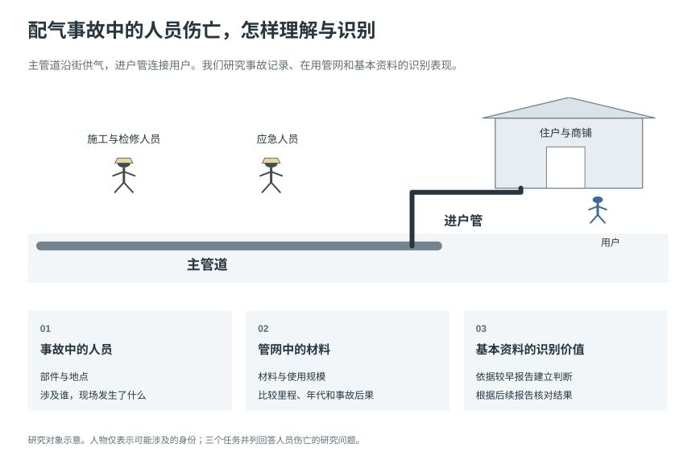
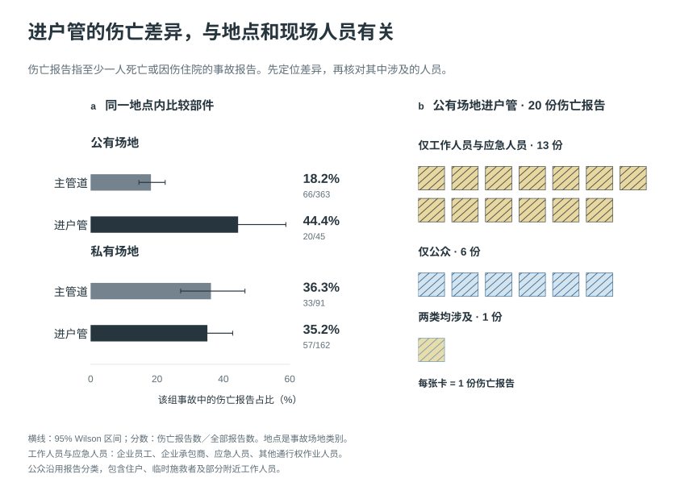
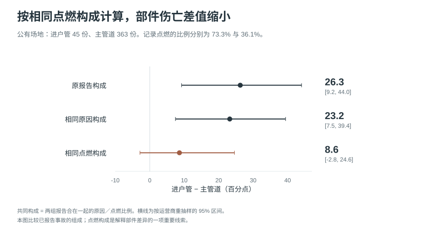
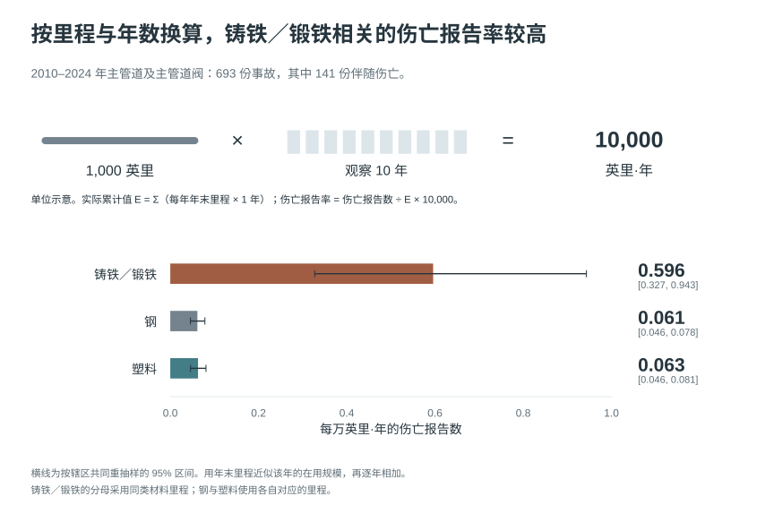
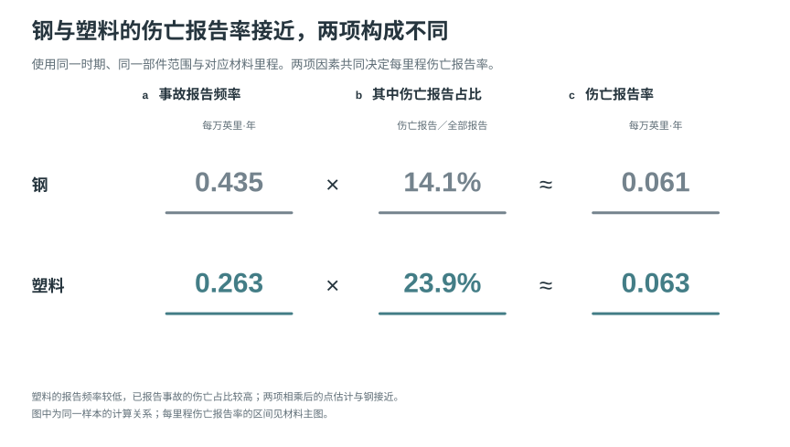
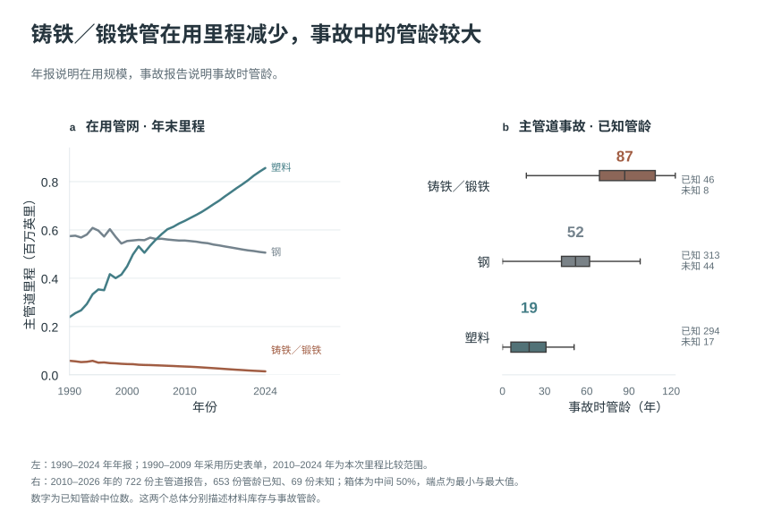
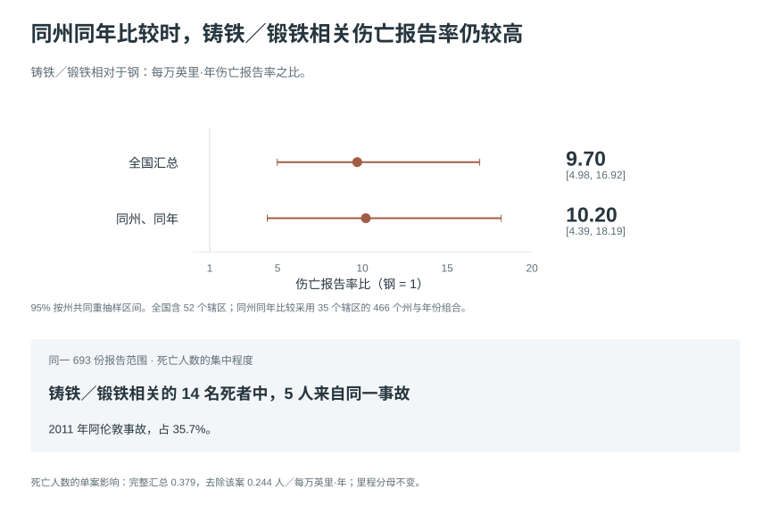
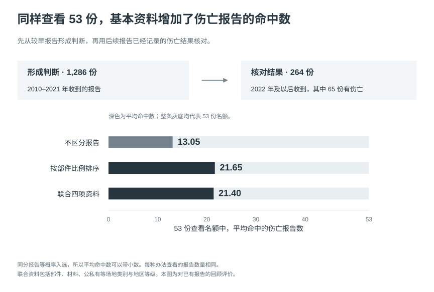
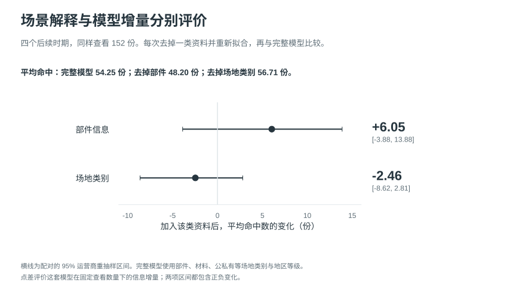

# 配气事故中的人员伤亡

燃气进入街区后，先沿主管道输送，再由进户管连接住户和其他用户。管道发生泄漏、火灾或爆炸时，可能受到影响的有居民、路人、施工人员，以及赶来检修和处置的人。安全管理需要知道哪些管网值得重点调查，也需要理解伤亡发生的具体场景。

部件、材料和地点，是事故报告中容易取得的基本资料。进户管连接用户，老旧铸铁／锻铁管使用多年，这些特征很容易让人形成直观判断。我们希望核实：凭这些资料，能否可靠地识别更容易伴随伤亡的配气事故？出现差异后，又该怎样解释？

图 1．主管道在街区内输气，进户管连接用户。图中人物用于说明可能涉及的人员，位置是示意。报告分别研究事故中的人员、管网中的材料，以及基本资料的识别价值。

我们使用美国管道与危险品安全管理局（PHMSA）的 1,550 份配气事故报告，事故发生于 2010 年至 2026 年 2 月。其中 369 份记录了人员伤亡。“伤亡报告”在本文中指至少一人死亡或因伤住院的事故报告；一份报告可以涉及多人。这批报告共记录 142 人死亡、652 人住院受伤。它们覆盖符合机构报送条件的事故。[PHMSA 事故资料与填报说明](https://www.phmsa.dot.gov/data-and-statistics/pipeline/distribution-transmission-gathering-lng-and-liquid-accident-and-incident-data)

事故报告说明发生了什么；管网年报补充各类管道有多长、何时安装。我们整理了 1990–2024 年的材料库存和 2004–2024 年的安装年代资料。下面先从进户管的直觉出发，查清场地与人员；再从管网调查的需要出发，比较材料、规模和年代；最后检验这些认识用于判断具体报告时有多少帮助。

## 1．部件、场地与伤亡人员

### 1.1 部件与场地的伤亡差异

进户管连接用户，我们最初预期：如果进户管事故更常伴随伤亡，这种差异应当主要涉及公众，而且在不同场地都能观察到。总体结果确实显示部件差异：进户管 241 份事故中，90 份伴随伤亡，占 37.3%；主管道为 146/726，占 20.1%。接下来需要确定，这个总体差异出现在哪些场地。

我们先把公有和私有场地的事故分别比较。报告还单列公用设施通行权场地，即公用设施具有建设、运行或维护使用权的场地，以及运营商控制的设施范围。各类按原记录分组；事故影响了哪些人、哪些建筑，则结合人员记录和事故经过理解。

图 2．左侧比较相同场地中的两种部件，标签给出伤亡报告数／全部报告数。右侧展开公有场地进户管的 20 份伤亡报告，每张小卡代表一份报告。

公有场地的进户管伤亡比例为 44.4%，主管道为 18.2%，相差 26.3 个百分点；私有场地的两者分别为 35.2% 和 36.3%，比例接近。总体差异由此变得具体：公有场地有明显差别，私有场地同时需要关注两种管道。公用设施通行权场地也呈相同方向，进户管为 37.5%，主管道为 16.9%；运营商控制场地只有 8 份报告，完整计数保留在支持表中。

### 1.2 公有场地进户管的伤亡人员

报告区分一般公众、燃气企业员工、为企业工作的承包商人员、应急人员，以及通行权区域中其他工作人员。下文把后四类合称“工作人员与应急人员”。“公众”沿用报告分类，包含住户、路人和未归入前四类的人，某些工作人员也可能归入公众。[PHMSA 人员分类说明，第 8 页](https://www.phmsa.dot.gov/sites/phmsa.dot.gov/files/2023-12/Current_GD_Incident_Instructions_PHMSA%20F%207100.1_2023-09%20and%20Beyond.pdf#page=8)

公有场地的 20 份进户管伤亡报告中，13 份仅涉及工作人员与应急人员，6 份仅涉及公众，1 份同时涉及两类。私有场地的情况不同：57 份进户管伤亡报告中，有 43 份涉及公众。进户管虽然连接用户，其伤亡构成仍随场地而变化。

这使最初的解释得到修正。进户管与主管道的总体伤亡比例有差异；公有场地进户管的伤亡，却以报告另列的工作人员与应急人员为主。理解这个现象，需要继续看他们参与了什么活动。

### 1.3 现场活动与事故组成

事故原因提供了一个线索。全部资料中，“不正确操作”和“非挖掘的车辆或机具撞击”都各有 59 份伤亡报告。前一类有 57 份涉及工作人员与应急人员，后一类有 57 份涉及公众。同样的伤亡报告数量，对应的是不同的人和活动。

原因与人员的对应关系说明，具体活动值得核对。我们阅读了公有场地全部 45 份进户管报告，并选取材料与事故年份相近的公有场地主管道、私有场地进户管报告各 45 份作对照。三组分别有 43/45、41/45 和 38/45 份记载本次作业或现场响应，活动在三组都很常见。公有场地进户管中，涉及工作人员与应急人员伤亡的 14 份报告也都有这类记录。我们于是继续核对具体作业和事故升级的时序，理解人员伤亡对应怎样的过程。

其中一份 2011 年报告记载，燃气企业员工正在维修进户管泄漏，用电池锯切除漏气管段时，燃气点燃，一名员工住院受伤。这份记录将部件、人员和正在进行的活动联系在同一个过程里。另一份 2019 年报告记载，电信施工损坏进户管，燃气企业人员到场约三分钟后，附近建筑爆炸；事故涉及公众、企业员工、消防人员及其他工作人员。公有场地的管道事故，也可能影响建筑中的人。

既然具体过程多次出现燃气点燃，我们进一步检查，两种部件的事故组成是否不同。公有场地进户管有 33/45 份报告记录点燃，占 73.3%；主管道为 131/363，占 36.1%。进户管的 20 份伤亡报告中，19 份有点燃记录。

图 3．三行分别表示原始伤亡比例差、按同一原因构成加权后的差、按同一点燃构成加权后的差。点和横线表示差值及运营商重抽样的 95% 区间；单位为百分点。

原始差异为 26.3 个百分点。让两种部件采用相同的事故原因构成后，差异为 23.2 个百分点；采用相同的点燃构成后，差异为 8.6 个百分点，95% 区间为 −2.8 至 24.6 个百分点。点燃构成是理解原始差异的重要线索。这个计算重新组合已经观察到的事故比例，用来说明两组记录的组成；具体致伤经过仍由事故叙述提供。

因此，进户管的部件标签要和事故场地、人员身份、现场活动一起理解。公有场地的事故复盘应具体记录施工、检修、燃气控制、点燃时序和人员位置；私有场地的公众伤亡则同时涉及主管道与进户管。我们的认识由“进户管靠近用户”，发展为对不同场景中实际人员和活动的区分。

### 1.4 部件差异的时期对照

我们还核对了总体部件差异的时期表现。按 PHMSA 收到报告的年份分组，2010–2021 年进户管为 36.2%，主管道为 21.6%；2022 年及以后分别为 45.2% 和 14.1%。收到年份记录资料何时进入系统，也对应第 3 章先用已取得资料学习、再评价后续报告的顺序。两个时期的方向一致；前面的场地与人员比较进一步说明了总体差异的具体情境。

## 2．材料、管网规模与建设年代

### 2.1 材料伤亡比例与单位管网报告率

管网调查还面临材料选择：哪些在用管道值得优先检查？这需要同时知道某种材料发生了多少事故，以及它在管网中使用得有多广、用了多久。材料研究直接服务于这个调查任务。

#### 2.1.1 材料类别与近期表现

原始表单把铸铁／锻铁、钢、塑料和球墨铸铁等列为不同类别。铸铁／锻铁与球墨铸铁分别填报，本文保持这两个类别，以便事故与年报使用相同的材料分类。先看全部事故中的后果：铸铁／锻铁管伤亡比例为 36.7%，钢为 22.4%，塑料为 26.6%。

| 材料 | 全时期：伤亡／全部 | 2010–2021 年收到 | 2022 年及以后收到 |
|---|---:|---:|---:|
| 铸铁／锻铁 | 22/60，36.7% | 20/53，37.7% | 2/7，28.6% |
| 钢 | 165/735，22.4% | 135/609，22.2% | 30/126，23.8% |
| 塑料 | 131/493，26.6% | 110/405，27.2% | 21/88，23.9% |
| 铜 | 2/13，15.4% | 2/12，16.7% | 0/1，0.0% |
| 球墨铸铁 | 0/4，0.0% | 0/4，0.0% | 0/0，无记录 |
| 其他 | 39/201，19.4% | 29/171，17.0% | 10/30，33.3% |
| 未知 | 10/44，22.7% | 8/32，25.0% | 2/12，16.7% |

近期铸铁／锻铁管的确切结果是 7 份中有 2 份伤亡报告，钢与塑料的伤亡占比则都约为 24%。这些比例描述事故已经发生后的后果。要比较整段管网的报告频率，下一步应加入管道长度和观察年数。

#### 2.1.2 管网规模与比较分母

一年有一万英里管道在用，与一千英里观察十年，累计规模都为一万英里·年。这是长度与时间相乘的单位。PHMSA 的官方报告也按“每若干英里、每年”比较事故率。[PHMSA 材料安全统计，表 8](https://www.phmsa.dot.gov/sites/phmsa.dot.gov/files/2023-07/Tier-1-PHMSA-2022-0123-0001.pdf#page=53)

我们逐年累计相同材料的主管道里程，再将对应事故数除以累计值。符号中，Lᵧ 是该年年末里程，E 是累计里程与时间，C 是相匹配的伤亡报告数：

E = ∑ Lᵧ × 1 年每万英里·年伤亡报告率 = C ÷ E × 10,000

年末里程代表该年的管网规模。此次匹配使用 2010–2024 年的主管道及主管道阀事故，材料与年份均和年报对应，共 693 份。铸铁／锻铁的分母采用年报对应的材料里程，与事故的材料类别一致。

图 4．每万英里·年的伤亡报告率：铸铁／锻铁管约 0.596，钢约 0.061，塑料约 0.063。单位解释与计算尺度同图给出，区间为州共同重抽样的 95% 区间。

铸铁／锻铁管对应的伤亡报告率约为钢的 9.70 倍。按州共同重抽样，95% 区间为 4.98–16.92。

### 2.2 钢与塑料的事故频率与伤亡后果

图 4 还有一项值得解释的认识：钢与塑料的每里程伤亡报告率接近。可是前面的全事故比较中，塑料的伤亡占比高于钢。这两项结果分别以管网规模和事故报告数为分母，可以同时成立。

在刚才匹配的 693 份报告中，钢有 347 份，其中 49 份伴随伤亡；塑料有 293 份，其中 70 份伴随伤亡。把计算写成两步，就能看清两者的关系：

每里程事故报告率 × 事故中的伤亡比例= 每里程伤亡报告率

图 5．钢为 0.435 × 14.1% ≈ 0.061；塑料为 0.263 × 23.9% ≈ 0.063。左右两项率均按每万英里·年计算，比例使用同一匹配样本。

塑料的事故报告频率较低，而事故中的伤亡占比较高，两项相乘后得到接近的结果。塑料相对钢的伤亡报告率比为 1.02，95% 区间为 0.71–1.38。这项发现使材料评价更具体：调查时分别报告事故频率和伤亡后果，才能说明不同材料的实际特征。

### 2.3 现存材料与管网年代

材料的使用范围也在变化。1990 年归档年报中的铸铁／锻铁管约为 5.83 万英里，到 2024 年约为 1.46 万英里。塑料在归档序列中于 2006 年首次超过钢；2024 年塑料约占主管道里程的 62.1%，铸铁／锻铁管约占 1.1%。铸铁／锻铁管库存虽然已经缩小，前面的单位管网比较仍显示较高的伤亡报告率。

调查现存铸铁／锻铁管时，还需要了解它的使用年代。我们用事故发生年减安装年计算事故时管龄。在三种主要材料的主管道事故中，653 份有可采用的安装年份，69 份仍未知。已知管龄中位数分别为铸铁／锻铁管 87 年、钢 52 年、塑料 19 年。

图 6．左侧是各年申报的材料库存，说明在用规模怎样变化；右侧是发生事故的主管道管龄，说明本研究事故样本的建设年代。两侧各自使用相应资料，不共用一个年龄分母。

已知管龄的塑料最大为 51 年，因此 60 年以上的比较使用实际有此类记录的铸铁／锻铁与钢。管龄至少 60 年的记录中，铸铁／锻铁管有 19/42 份伴随伤亡，钢为 14/101，分别为 45.2% 和 13.9%。同属这个较宽的老管组，铸铁／锻铁管与钢的年龄中位数仍分别为 91 年和 66 年。调查对象因此具体到仍在使用的材料与年代组合，管龄与材料需并列记录。管网年报进一步显示，2024 年仍有 32.0 万英里主管道安装于 1970 年以前，年代本身也是调查线索。

### 2.4 地区构成与严重事故

地区比较采用 2010–2024 年铸铁／锻铁与钢的主管道及主管道阀报告，并匹配对应年度和材料的主管道里程。

2024 年，现存铸铁／锻铁里程有 58.8% 集中在新泽西、纽约、马萨诸塞和宾夕法尼亚四州。为核对地区与年份构成对比较的影响，我们比较相同州、相同年份中均有记录里程的铸铁／锻铁与钢，铸铁／锻铁相对钢的每里程伤亡报告率比为 10.20，区间为 4.39–18.19。加入管网规模、地区和年份后，现存铸铁／锻铁管仍是明确的调查重点。

一份伤亡报告可能涉及一人，也可能涉及多人。因此，我们同时统计死亡人数和住院伤者人数。693 份匹配报告中，铸铁／锻铁管记录 14 人死亡、29 人住院受伤；钢为 7 人、79 人；塑料为 15 人、101 人。

图 7．上方比较铸铁／锻铁与钢的每里程伤亡报告率，分别给出总体及两种材料都有记录里程的同州年比较和 95% 区间。下方另按死亡人数显示阿伦敦事故的集中程度；两种指标共同支持调查重点与人员后果的判断。

保留完整记录时，铸铁／锻铁管每万英里·年死亡人数约为 0.379；在固定里程分母的影响核查中，去除阿伦敦这一份报告后约为 0.244，钢为 0.009。现存铸铁／锻铁管的调查重点仍有依据，同时需要清楚呈现少数严重事故对人数结果的影响。

材料研究最终形成两个判断：现存铸铁／锻铁管与老旧管网值得重点调查；钢与塑料的比较应分别考虑事故频率和人员后果。使用规模、建设年代和事故人数共同说明了这些判断的依据。

## 3．基本资料的识别价值

### 3.1 后续报告的识别结果

#### 3.1.1 评价资料与比较方法

前两章已经确定了部件、地点和材料的分组差异。现在回到研究起点的另一部分：这些基本资料对于判断某一份报告是否伴随伤亡，有多少帮助？我们用较早报告形成规则，再用后续收到的报告评价排序，核对被选中的报告实际记录了什么后果。

具体做法是，用 2010–2021 年收到的 1,286 份报告学习，将 2022 年及以后收到的 264 份留作检验。这批检验报告中实际有 65 份伴随伤亡。三种办法分别是：给每份报告相同分数；按部件过去的伤亡比例排序；用逻辑回归联合部件、材料、地点和地区等级。地区等级按管线周边的建筑与人员集中场所划分，用来描述周边建成环境。[地区等级定义](https://www.govinfo.gov/content/pkg/CFR-2025-title49-vol3/pdf/CFR-2025-title49-vol3-sec192-5.pdf)

模型根据较早报告中基本特征与伤亡的关系，为每份后续报告计算分数。得分越高，越优先选取复核。随后，我们用这些后续报告实际记录的伤亡结果，核对选取结果。

#### 3.1.2 相同查看数量下的识别表现

为了在相同查看数量下比较，我们统一选取约五分之一，即 53 份报告。没有排序信息时，平均可选中约 13.05 份伤亡报告；按部件排序约为 21.65 份，联合模型约为 21.40 份。

图 8．三行均选 53 份报告，比较其中平均有多少份伴随伤亡。部分报告得分相同，按等概率入选处理，因而平均命中数可以是小数。

部件资料已经提供了高于不区分报告的排序信息。在这一批后续记录、相同的查看数量下，联合模型与简单部件规则选中的伤亡报告数接近。这个结果给出了直接的采用依据：保留清楚可复核的部件参照，再评价额外资料带来的增量。

#### 3.1.3 标记数量与识别指标

图 8 固定查看数量，便于比较排序信息。下面再看按照分数规则标记报告时，选中的报告有多准、遗漏了多少。各办法使用在较早资料中确定的阈值，因此标记数量可以不同。精确率是被标记报告中实际伴随伤亡的比例；召回率是全部伤亡报告中被找出的比例。AP 将不同排序位置上的精确率与召回表现概括为一个指标，数值越高表示排序越有利于优先找到伤亡报告。

| 方法 | 标记报告数 | 找到的伤亡报告 | 精确率 | 召回率 | AP |
|---|---:|---:|---:|---:|---:|
| 相同分数参照 | 264 | 65 | 24.6% | 100.0% | 0.246 |
| 部件规则 | 249 | 62 | 24.9% | 95.4% | 0.322 |
| 逻辑回归 | 80 | 33 | 41.3% | 50.8% | 0.336 |

逻辑回归标记 80 份，其中 33 份伴随伤亡，精确率较高；它同时找到了全部 65 份伤亡报告中的约一半。部件规则标记的数量更多，也找到了更多伤亡报告。把这张表与图 8 一起读，就能区分阈值选择的结果与相同查看数量下的排序信息。

### 3.2 多时期的识别表现与信息增量

为了判断多加一类资料究竟增加多少识别信息，我们保持逻辑回归的建模方式不变，每次去掉一类输入、重新拟合。这就是输入消融。我们再把学习与评价的分界移到四个不同时段，每次只用较早资料学习、用随后两年的报告评价。四批共 747 份，每批统一查看约五分之一，合计 152 个名额。完整模型平均命中 54.25 份伤亡报告，去掉部件后为 48.20 份，去掉公有、私有等场地类别后为 56.71 份。

图 9．完整模型与去掉一类输入的模型比较，均使用相同的 152 个查看名额。加入部件的平均命中增量为 6.05 份，95% 区间为 −3.88 至 13.88；加入场地类别为 −2.46 份，区间为 −8.62 至 2.81。区间按运营商联合重抽样计算。

第一章按公有、私有等场地比较后，我们明确了不同的人员处境；这一分类在当前逻辑回归中的额外排序收益，则由图 9 的比较另行评价。两项增量区间都同时覆盖收益和损失，逐项加入信息的增益估计还较宽。额外变量的用途需要由实际比较确认，而部件规则本身已经提供了清楚的排序参照。

多时期的随机森林补充比较也与此相符：共同名额下平均命中 56.00 份，部件规则为 52.38 份；召回率差为 2.19 个百分点，95% 区间为 −4.81 至 7.57。我们据此保留简单参照，并报告联合信息的实际收益与估计范围。

基本资料可以帮助排序；对于前两章看到的人员差异和事故过程，还需要相应的现场记录来解释。这样，识别实验与人员、材料研究共同回答了开篇的问题。

## 综合判断与管理用途

事故复盘应把部件、场地、人员身份和现场活动放在一起考虑。公有场地进户管的较高伤亡比例，主要涉及报告另列的工作人员与应急人员，施工、检修与泄漏处置是重要的复盘内容。

管网调查应重点关注现存铸铁／锻铁管与老旧管网，并同时报告事故频率和人员后果。钢和塑料的比较说明，单看事故中的伤亡比例，无法完整说明单位管网的伤亡报告水平。

基本资料的识别价值应以明确的简单参照和相同的查看数量评价。本研究保留部件规则，并用联合模型检验额外信息带来的实际收益。

完整计算、分类依据、来源与补充分析见[方法与核查记录](methods.md)。
