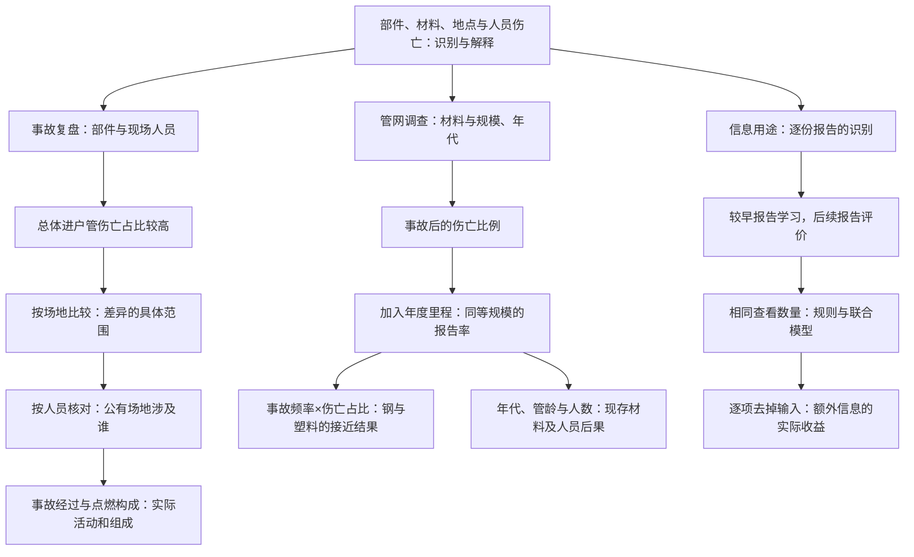

# 配气事故研究的讲述路线 v2.1

主稿采用导言加三个主体。导言说明街区配气系统、研究用途、伤亡报告定义和两类资料。原先单独的来源章并入导言，具体计量单位在首次需要时解释。

总体问题是：凭管道的部件、材料和地点，能否可靠地识别更容易伴随伤亡的配气事故？这些判断怎样解释？

## 总体问题与三个主体

| 主体 | 现实用途 | 已形成的认识 |
|---|---|---|
| 事故场地与人员 | 复盘哪些人、哪些活动和过程 | 进户管的总体伤亡比例较高；场地与人员构成确定了具体情境，公有场地的报告更多涉及工作人员与应急人员 |
| 材料与管网 | 确定现存管网的调查重点 | 铸铁／锻铁与老旧管网值得关注；钢与塑料须同时比较事故频率和事故后果 |
| 基本资料的识别 | 判断已有线索对具体报告排序的帮助 | 简单部件规则提供了主要参照，联合信息按相同查看数量和实际增量评价 |

人员与材料是总问题下的并列研究。识别实验再检验基本资料的信息用途。下图箭头表示研究追问的顺序，不表示已识别的事故因果关系。

## 图的讲述任务

| 图 | 一句主要认识 | 在论述中的位置 |
|---|---|---|
| 1．管网示意 | 主管道连接街区，进户管连接用户，事故可涉及多类人员 | 导言建立共同背景，并列说明三项研究任务 |
| 2．人员 Teaser | 场地不同，部件差异和伤亡人员构成也不同 | 从总体部件差异推进到场地和人员 |
| 3．点燃构成 | 两类事故的点燃组成不同，是理解伤亡比例差的线索 | 具体过程之后，比较事故组成 |
| 4．材料 Teaser | 相同累计管网规模下，铸铁／锻铁的伤亡报告率较高，钢与塑料的点估计接近 | 给出长度×年份的尺度，再比较材料 |
| 5．频率与后果 | 塑料事故报告频率较低、事故中伤亡占比较高，两项相乘得到接近钢的率 | 解释材料指标之间的关系 |
| 6．库存与管龄 | 在用材料的规模与发生事故管道的年代，共同确定调查背景 | 明确两套资料的观察对象，定位现存材料与年代组合 |
| 7．率比与严重事故 | 地区、年份比较支持调查重点，人员数还需呈现集中程度 | 用区间和人数解释重点的依据 |
| 8．识别 Teaser | 同选 53 份，部件规则与联合模型平均找到约 21 份伤亡报告 | 以共同查看数量解释识别信息 |
| 9．输入消融 | 场景解释的用途与固定模型中的信息增量分别评价 | 用实际去掉输入的结果说明采用决定 |

图与正文使用同一数值来源。人员图的卡片代表报告；人数图采用人数；图示管线和人物仅解释对象。图形、正文与图注共同承担解释，避免一段话反复重述图中数字。

## 已执行的取舍

原题的部件、材料、地点、时期对照、兼容里程、指定时期三方法评价保留。全材料表、精确率／召回率／AP 表在正文中给出，指标先解释再使用。

全十类部件概览、全部原因表、逐份编码和清理、历史字段映射、逐窗预测、全部消融、其他敏感性结果放方法与支持材料。改变解释的事实仍在正文，包括三组现场活动均常见、共同点燃构成的区间、材料之间年龄仍有差异，以及严重事故对死亡人数的影响。

中文主稿：[研究主稿 v2.1](manuscript_zh.md)。英文主稿：[research manuscript v2.1](manuscript_en.md)。方法及来源：[研究方法与核查](methods.md)。
