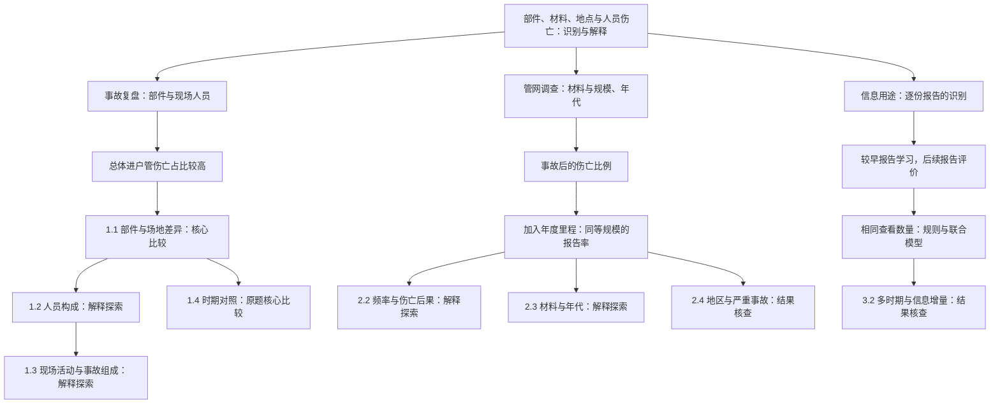

# 配气事故研究的讲述路线 v2.1

主稿采用研究背景、三个主要研究和独立的综合判断。三个主要研究分别讨论部件与人员、材料与管网、基本资料的识别价值。综合判断汇合三项研究的管理用途。

总体问题是：凭管道的部件、材料和地点，能否可靠地识别更容易伴随伤亡的配气事故？这些判断怎样解释？

## 总体问题与主要研究

| 主体 | 现实用途 | 已形成的认识 |
|---|---|---|
| 事故场地与人员 | 复盘哪些人、哪些活动和过程 | 进户管的总体伤亡比例较高；场地与人员构成确定了具体情境，公有场地的报告更多涉及工作人员与应急人员 |
| 材料与管网 | 确定现存管网的调查重点 | 铸铁／锻铁与老旧管网值得关注；钢与塑料须同时比较事故频率和事故后果 |
| 基本资料的识别 | 判断已有线索对具体报告排序的帮助 | 简单部件规则提供了主要参照，联合信息按相同查看数量和实际增量评价 |

人员与材料是总问题下的并列研究。识别实验再检验基本资料的信息用途。下图箭头表示研究追问的顺序，不表示已识别的事故因果关系。

## 目录与分析职责

核心比较直接回答原题；解释探索承接已经观察到的差异，解释人员构成、事故过程或指标含义；结果核查检查比较的成立范围及额外信息的收益。章节先后表示讲述顺序，分析职责由具体任务决定。第三章是主要研究；其中的多时期与输入消融属于支持识别判断的核查。人员章末的时期对照则保留原 proposal 的近期比较任务。

以下采用两级主体目录。材料的比例与里程、识别的评价方法与两种选取方式，在正文中按需要展开第三级。章标题和小节标题均采用名词短语。

| 编号 | 目录标题 | 分析职责 | 承接 | 本节成果 |
|---|---|---|---|---|
| 1.1 | 部件与场地的伤亡差异 | 核心比较 | 总问题 | 进户管总体伤亡占比较高；公有场地差异明显，私有场地接近 |
| 1.2 | 公有场地进户管的伤亡人员 | 解释探索 | 1.1 | 明确公有场地进户管伤亡报告主要涉及工作人员与应急人员 |
| 1.3 | 现场活动与事故组成 | 解释探索 | 1.2 | 作业、响应时序与点燃构成解释现场情境；三组活动均常见 |
| 1.4 | 部件差异的时期对照 | 核心比较 · 时期核查 | 1.1 | 总体部件关系在较早与近期报告中方向一致 |
| 2.1 | 材料伤亡比例与单位管网报告率 | 核心比较 | 总问题 | 全材料与近期比较、兼容里程比较共同确定材料调查线索 |
| 2.2 | 钢与塑料的事故频率与伤亡后果 | 解释探索 | 2.1 | 较低事故频率与较高条件伤亡比例形成接近的单位管网结果 |
| 2.3 | 现存材料与管网年代 | 解释探索 | 2.1 | 在用规模、安装年代与事故管龄定位现存材料和年代组合 |
| 2.4 | 地区构成与严重事故 | 结果核查 | 2.1 | 同州年比较与单案影响说明材料判断的依据和人员结果的集中程度 |
| 3.1 | 后续报告的识别结果 | 核心比较 | 总问题 | 原定三方法评价；共同查看数量与精确率、召回率、AP 各有明确含义 |
| 3.2 | 多时期的识别表现与信息增量 | 结果核查 | 3.1 | 多时期、逐项消融和其他模型的实际收益支持简单参照的采用判断 |

1.2 和 1.3 依次解释 1.1 的人员及现场关系。2.2、2.3、2.4 分别回应 2.1 的指标含义、年代背景和结果稳定性，是同一材料问题的不同追问。3.2 核查 3.1 的识别结果。每项后续分析均有母问题与实际成果。

## Proposal 与当前研究的对应

10 月 6 日初稿、10 月 7 日发送稿和 10 月 16 日教师返回件采用同一个研究对象。当前主样本仍为 1,550 份配气事故报告，369 份记录死亡或需住院伤害。10 月 7 日加入的部件参照和每里程比较，以及教师明确的分母匹配、近期对照和模型指标，均保留在核心分析中。

| 原题内容 | 当前结果与采用判断 | 后续分析的具体作用 |
|---|---|---|
| 进户管与主管道的差异、近期表现 | 全期分别为 37.3% 和 20.1%；近期总体方向保留，场地分层明确了差异范围 | 人员构成和事故经过解释公有场地进户管伤亡报告主要涉及的人员 |
| 铸铁与其他材料的伤亡比例、兼容里程率 | 保留全材料及近期表；铸铁／锻铁相对钢的每里程伤亡报告率比约为 9.70 | 钢／塑料的频率与后果分解、材料年代探索、同州年和单案核查分别解释指标、背景与稳定性 |
| 较早资料学习、2022 年及以后评价，逻辑回归与两个参照 | 保留原三方法及精确率、召回率、AP；同选 53 份时，常数参照、部件规则与逻辑回归平均命中 13.05、21.65、21.40 份 | 共同查看量明确比较条件；多时期与消融衡量额外信息的实际收益 |
| 检查与更换的管理含义 | 管理产出具体为事故复盘重点、在用材料与年代调查重点、简单识别参照 | 研究给出明确关注对象；实际更换先后还需对应资产、成本和干预资料 |

“进户管连接用户，因此较高伤亡比例主要涉及公众”是后续讲述中加入的解释假设。当前人员分析修正了这层解释：公有场地进户管的 20 份伤亡报告中，14 份涉及工作人员与应急人员。原题中的总体部件差异、材料比较与模型评价继续构成主要研究。

## 图的讲述任务

| 图 | 一句主要认识 | 在论述中的位置 |
|---|---|---|
| 1．管网示意 | 主管道连接街区，进户管连接用户，事故可涉及多类人员 | 导言建立共同背景，并列说明三项研究任务 |
| 2．人员 Teaser | 场地不同，部件差异和伤亡人员构成也不同 | 从总体部件差异推进到场地和人员 |
| 3．点燃构成 | 两类事故的点燃组成不同，是理解伤亡比例差的线索 | 具体过程之后，比较事故组成 |
| 4．材料 Teaser | 相同累计管网规模下，铸铁／锻铁的伤亡报告率较高，钢与塑料的点估计接近 | 给出长度×年份的尺度，再比较材料 |
| 5．频率与后果 | 塑料事故报告频率较低、事故中伤亡占比较高，两项相乘得到接近钢的率 | 解释材料指标之间的关系 |
| 6．库存与管龄 | 在用材料的规模与发生事故管道的年代，共同确定调查背景 | 明确两套资料的观察对象，定位现存材料与年代组合 |
| 7．率比与严重事故 | 地区、年份比较支持调查重点，人员数还需呈现集中程度 | 用区间和人数解释重点的依据 |
| 8．识别 Teaser | 同选 53 份，部件规则与联合模型平均找到约 21 份伤亡报告 | 以共同查看数量解释识别信息 |
| 9．输入消融 | 场景解释的用途与固定模型中的信息增量分别评价 | 用实际去掉输入的结果说明采用决定 |

图与正文使用同一数值来源。人员图的卡片代表报告；人数图采用人数；图示管线和人物仅解释对象。图形、正文与图注共同承担解释，避免一段话反复重述图中数字。

## 已执行的取舍

原题的部件、材料、地点、时期对照、兼容里程、指定时期三方法评价保留。全材料表、精确率／召回率／AP 表在正文中给出，指标先解释再使用。

全十类部件概览、全部原因表、逐份编码和清理、历史字段映射、逐窗预测、全部消融、其他敏感性结果放方法与支持材料。改变解释的事实仍在正文，包括三组现场活动均常见、共同点燃构成的区间、材料之间年龄仍有差异，以及严重事故对死亡人数的影响。

中文主稿：[研究主稿 v2.1](manuscript_zh.md)。英文主稿：[research manuscript v2.1](manuscript_en.md)。方法及来源：[研究方法与核查](methods.md)。
